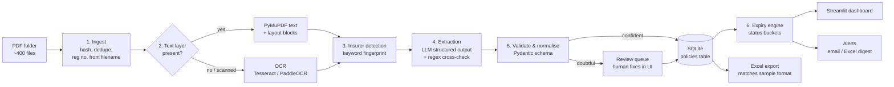
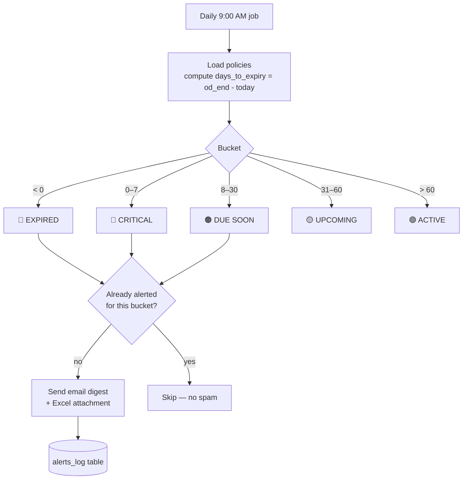

# Vehicle Insurance Tracker — Project Plan

> Goal: turn ~400 motor-insurance PDFs from many insurers, each in its own layout, into **one clean, accurate table**. On top of that table: a **dashboard** and an **automated expiry tracker** that sends alerts.

---

## 1. What we are building

| Requirement (from the assignment) | How we deliver it |
|---|---|
| Vehicle Chassis Number | Extracted from each PDF and checked against VIN/chassis format rules |
| Own Damage (OD) insurance details | Policy type, OD premium, IDV, OD period |
| Fire coverage (Yes/No) | Derived from policy type and the clause text (rules below) |
| Chassis damage coverage + causes | List of covered perils (accident, fire, flood, theft…) pulled from the policy |
| Insurance company name | Detected from the PDF fingerprint (logo text, IRDAI reg. no., domain) |
| Automated expiry tracker/trigger | Daily job puts each policy in an expiry bucket and sends alerts |
| Clean, accurate, easy to analyse | Validation layer, review queue for doubtful fields, filters, Excel export |

### What the data looks like (from the folder scan)

```
HR Assignment/
├── Expired insurance before nov-26/   → already expired
├── expire due nov and dec-26/         → expiring soon (Nov–Dec 2026)
└── insurance 2027/                    → valid into 2027
```
- File names hold the **registration number**, e.g. `KA01AB1234 Insurance.pdf`, `KA01AB1235.pdf`, `KA01AB1236 (3).pdf`.
  We'll use the file name as a **cross-check key**. It is not the source of truth.
- The three folders give us a **free ground-truth label** for expiry status. We'll use them to test the extracted expiry dates.
- The file names show duplicates and copies (`(3)`), so we need **de-duplication** (file hash + policy number).

---

## 2. Architecture (simple, layered, no over-engineering)



### Why this shape
- **One pipeline, many insurers.** We don't write 15 parsers. The LLM reads any layout into one fixed JSON schema. Regex checks the fields that are easy to verify (chassis, dates, policy no.). Only the deterministic checks need code per field. Nothing needs code per insurer.
- **Re-run safe.** Each PDF is keyed by its file hash. Re-running the pipeline only processes new or changed files, so new policies can be dropped into the folder at any time.
- **Trust but verify.** Every extracted record gets a confidence score. Low-confidence records go to a review queue and never silently enter the dashboard.

---

## 3. Tech stack

| Layer | Tool | Why |
|---|---|---|
| Language | **Python 3.11** | Best PDF, OCR and data ecosystem |
| PDF text | **PyMuPDF (`fitz`)** | Fast, keeps layout blocks, also renders pages to images for OCR |
| OCR fallback | **Tesseract** (`pytesseract`) or **PaddleOCR** | Only for scanned PDFs with no text layer |
| Extraction | **Claude API** (`claude-sonnet-5-5`; `claude-haiku-5-5` for cheap bulk runs) with structured JSON output | Handles every insurer layout with one prompt and one schema |
| Validation | **Pydantic v2** | Typed schema, enums, date parsing, field validators |
| Storage | **SQLite** (via `sqlite3` / SQLModel) | Zero setup, one file, plenty for thousands of rows |
| Dashboard | **Streamlit** + **Plotly** / `st.dataframe` | Interactive table and charts in about 200 lines, no front-end build |
| Scheduler | **APScheduler** (in-app) or **Windows Task Scheduler** / cron running `python -m tracker.alerts` | Daily expiry check |
| Alerts | SMTP email (Gmail app password) + Excel digest attachment | Simple and reliable. Can grow to WhatsApp or Slack later |
| Export | **pandas + openpyxl** | Excel with conditional formatting (red/amber/green) |
| Config | `.env` + `config.yaml` | API keys and alert thresholds stay out of code |

> **Offline alternative** (if an API is not allowed): use a local LLM through **Ollama** (e.g. Qwen2.5-7B / Llama 3.1 8B) with the same prompt and schema. It's slower and a bit less accurate, but the architecture doesn't change because the extractor sits behind an interface.

---

## 4. Data model (one table to rule them all)

```text
policies
├── id                      PK
├── file_name, file_hash    (dedupe + traceability)
├── source_folder           (expired / due-nov-dec / 2027 → test label)
├── registration_no         e.g. KA01AB1234 (normalised: no spaces/dashes)
├── chassis_no              17-char VIN or OEM chassis format
├── engine_no
├── make_model, vehicle_class, year_of_mfg, fuel
├── insurer_name            normalised to canonical list
├── policy_no
├── policy_type             Comprehensive | Standalone OD | Liability Only (TP) | Bundled
├── od_start, od_end        Own-Damage period
├── tp_start, tp_end        Third-Party period (often different!)
├── idv                     Insured Declared Value
├── od_premium, tp_premium, total_premium
├── ncb_percent
├── fire_covered            Yes | No | Unclear
├── chassis_damage_covered  Yes | No | Unclear
├── covered_causes          JSON list: [Accident, Fire, Explosion, Self-ignition, Lightning,
│                                       Burglary/Theft, Riot/Strike, Malicious act, Terrorism,
│                                       Flood/Cyclone/Storm, Earthquake, Landslide, Transit]
├── addons                  JSON list: Zero Dep, Engine Protect, RSA, RTI, Consumables…
├── hypothecation           financier name, if any
├── extraction_confidence   0–1
├── review_status           auto_ok | needs_review | reviewed
├── days_to_expiry          (computed)
└── expiry_status           (computed, see §6)
```

### Business rules for the "tricky" fields
- **Fire coverage = Yes** if the policy type is Comprehensive, Package or Standalone OD. Indian OD sections (IMT tariff wording) cover *fire, explosion, self-ignition, lightning*.
  **= No** if the policy is *Liability Only / Act Only*.
  **= Unclear** if neither the type nor the wording is found. Unclear records go to the review queue.
- **Chassis damage coverage** follows the OD section. If OD exists, damage to the vehicle including the chassis is covered for the listed perils. The `covered_causes` list is pulled from the policy text and mapped to the canonical list above.
- **Expiry date used for tracking = `od_end`** (the requirement is about OD). We also store `tp_end` because long-term TP cover (3 or 5 years) often outlives OD.

---

## 5. Pipeline steps in detail

### Step 1 — Ingest
- Walk the folder recursively and skip `.zip` files.
- Compute SHA-256. If the hash is already in the DB, skip the file (idempotent).
- Parse the registration number from the file name with a regex: `[A-Z]{2}\d{1,2}[A-Z]{1,3}\d{4}`.

### Step 2 — Text extraction
- Run `page.get_text("text")` with PyMuPDF. If a page yields fewer than ~50 characters, treat it as scanned, render it at 300 dpi and OCR it.
- Usually only **page 1–2** matter (the schedule), which saves time and tokens. Fall back to all pages if key fields are missing.

### Step 3 — Insurer detection
- A dictionary of fingerprints, e.g. `"ICICI Lombard"`, `"Bajaj Allianz"`, `"TATA AIG"`, `"HDFC ERGO"`, `"New India Assurance"`, `"United India"`, `"Digit"`, `"SBI General"`, `"Reliance General"`, `"Royal Sundaram"`, `"Shriram General"`, `"IFFCO Tokio"`, `"Future Generali"`, `"Chola MS"`…, plus IRDAI registration numbers.
- This gives a **canonical insurer name** (no "ICICI Lombard GIC Ltd." vs "ICICI LOMBARD" duplicates), so charts group correctly.

### Step 4 — Extraction (core)
- One prompt: *"Extract these fields from this Indian motor insurance policy schedule. Return JSON matching the schema. Use null if not present; do not guess."*
- **Structured output** (JSON schema / tool use) makes the model return valid typed JSON.
- **Regex cross-check** for the high-value fields:
  - Chassis: `\b[A-HJ-NPR-Z0-9]{17}\b` (VIN), with an OEM fallback pattern.
  - Registration: must match the file name.
  - Dates: `dd/mm/yyyy`, `dd-Mon-yyyy` and similar. `od_end` must come after `od_start`.
  If the LLM and regex disagree, lower the confidence and send the record to review.
- Cache each raw LLM response to `cache/<hash>.json`, so re-runs and prompt changes don't re-pay for unchanged files.

### Step 5 — Validate and normalise
- Pydantic model: enums for policy type and Yes/No, date parsing, `₹1,23,456` → `123456`.
- Confidence score = required fields present + regex agreement + registration match + date sanity.
- `confidence < 0.8` → `needs_review`.

### Step 6 — Expiry engine (see §6)

---

## 6. Expiry tracker and trigger



- Thresholds live in `config.yaml` (`critical: 7, due_soon: 30, upcoming: 60`), so the team can change them without touching code.
- **Alert de-duplication.** An `alerts_log(policy_id, bucket, sent_on)` table means each policy is alerted only once per bucket change, plus an optional weekly reminder for expired policies.
- The **digest email** lists policies grouped by bucket, with registration no., insurer, OD end date and days left.
- The same logic runs live in the dashboard, so the status is always current even between job runs.

---

## 7. Dashboard (Streamlit)

**Top KPI row:** Total vehicles · Active · Due ≤30 days · Expired · Needs review · Total IDV insured

**Pages / tabs**
1. **Overview**: KPI cards, donut chart of expiry status, bar chart of policies per insurer, timeline of expiries by month for the next 12 months.
2. **Policy table** (the main deliverable): every column from §4, colour-coded status, search by registration or chassis, filters (insurer, status, policy type, fire Yes/No, add-ons), **Download Excel** button.
3. **Expiry tracker**: only the expired, critical and due-soon policies, sorted by days left, with a "Send alert now" button.
4. **Review queue**: low-confidence records next to the PDF text, editable fields and an Approve button. Edits are written back to the DB.
5. **Vehicle detail**: everything about one vehicle plus a link to open the original PDF.

**Extra features that make it stand out (all cheap to build)**
- ✅ **Data quality panel**: the % of fields auto-extracted vs reviewed, and a list of PDFs that failed.
- ✅ **Coverage gap finder**: vehicles with *TP-only* cover (no fire or OD protection), vehicles without Zero-Dep, and OD expired while TP is still active.
- ✅ **Insurer analytics**: average premium, IDV per insurer, and premium/IDV ratio (helps renewal negotiation).
- ✅ **Renewal calendar**: a month view of upcoming expiries.
- ✅ **Duplicate detector**: the same chassis appearing under two policies or registrations.
- ✅ **Folder-label accuracy check**: compares the extracted status with the source folder. It proves the extraction is accurate, which is good for the assignment demo.

---

## 8. Project structure (lean)

```
insurance-tracker/
├── config.yaml               # thresholds, paths, insurer list, alert emails
├── .env                      # API key, SMTP creds (git-ignored)
├── requirements.txt
├── tracker/
│   ├── ingest.py             # walk folder, hash, dedupe, reg-no from filename
│   ├── pdf_text.py           # PyMuPDF + OCR fallback
│   ├── insurers.py           # fingerprint → canonical insurer name
│   ├── extract.py            # LLM call + regex cross-check + cache
│   ├── schema.py             # Pydantic Policy model + business rules
│   ├── db.py                 # SQLite read/write
│   ├── expiry.py             # bucket logic (pure function → easy to test)
│   ├── alerts.py             # daily job: compute → dedupe → email
│   └── export.py             # Excel with conditional formatting
├── app.py                    # Streamlit dashboard
├── run_pipeline.py           # CLI: python run_pipeline.py --folder "..."
├── tests/
│   ├── test_expiry.py
│   ├── test_schema.py
│   └── gold/                 # 20–30 hand-verified PDFs → expected JSON
└── data/
    ├── tracker.db
    └── cache/                # raw extraction JSON per file hash
```
About **800–1,000 lines** of code in total. No microservices, no front-end framework, no Docker required (it can be added for deployment).

---

## 9. Development roadmap

| Phase | Work | Output | Est. |
|---|---|---|---|
| 0. Discovery | Open ~15 PDFs across insurers. List the insurers. Note scanned vs text PDFs. Map the sample Excel columns | Field list + insurer list | 0.5 day |
| 1. Extraction core | `pdf_text`, `insurers`, `extract`, `schema` on 20 PDFs | JSON for 20 files | 1 day |
| 2. Gold set and accuracy | Hand-verify 25 PDFs (mixed insurers). Measure field accuracy. Tune the prompt and regex | Accuracy report (target ≥ 98% chassis/dates) | 0.5 day |
| 3. Full run | Run all ~400, store in SQLite, triage the review queue | Clean DB + Excel | 0.5 day |
| 4. Dashboard | Overview, table, filters, export, review queue | Streamlit app | 1 day |
| 5. Tracker and alerts | Expiry engine, scheduler, email digest, alert log | Daily automated alerts | 0.5 day |
| 6. Polish | Extra features, README, demo screenshots | Submission-ready | 0.5 day |

**Total: about 4–5 working days.**

---

## 10. Accuracy and testing strategy
- **Gold set**: 25 PDFs verified by hand, at least 1–2 per insurer. Re-run after every prompt change and track per-field accuracy.
- **Free labels**: the source folder must agree with the computed status. Any mismatch flags either an extraction error or a data issue.
- **Unit tests** for the pure logic: `expiry.py` buckets, date parsing, fire/chassis rules.
- **Invariants**: chassis unique per vehicle, `od_end > od_start`, registration in the PDF = registration in the file name.

---

## 11. Maintenance and operations
- **Adding new policies**: drop the PDF in the folder and run `python run_pipeline.py`. Only new files are processed (hash-based).
- **New insurer format**: usually nothing to do (the LLM generalises). If its name isn't recognised, add one line to the insurer fingerprints in `config.yaml`.
- **Renewals**: a new PDF for the same chassis creates a new policy row, and the dashboard shows the **latest** policy per vehicle. History is kept.
- **Cost control**: cache by hash, send only pages 1–2, use the Haiku model for bulk runs and Sonnet for retries.
- **Backups**: `tracker.db` is one file. Copy it to OneDrive or Drive daily.
- **Logs**: `logs/pipeline.log` records every file's outcome (ok / review / failed + reason).
- **Security**: policies contain personal data (names, addresses). Keep the DB local or private, keep `.env` out of git, and mask owner names in any demo.

---

## 12. Future scope (mention in the presentation)
- Watch folder / Google Drive / email inbox → auto-ingest new policies.
- WhatsApp or Slack alerts, and auto-creation of renewal tasks.
- Vahan/RTO API lookup to verify chassis ↔ registration.
- Multi-user login with role-based access (FastAPI + React) if this grows past an internal tool.
- Claim history tracking per vehicle.

---

## 13. Open questions (answers will fine-tune this plan)
1. **Sample Excel**: the email mentions one, but I didn't find it in the shared folder. Its column order should become our export format.
2. **LLM API allowed?** Can the solution call a cloud API (Claude), or must it run fully offline? (Offline means Ollama plus more regex.)
3. **Delivery format**: will the reviewer run it locally (Streamlit), or do you need a hosted link (Streamlit Community Cloud) or Excel/Power BI only?
4. **Expiry thresholds and alert channel**: are 7/30/60 days fine? Should alerts go by email, and to whom?
5. **Are any PDFs scanned images?** This decides whether we must install Tesseract.
